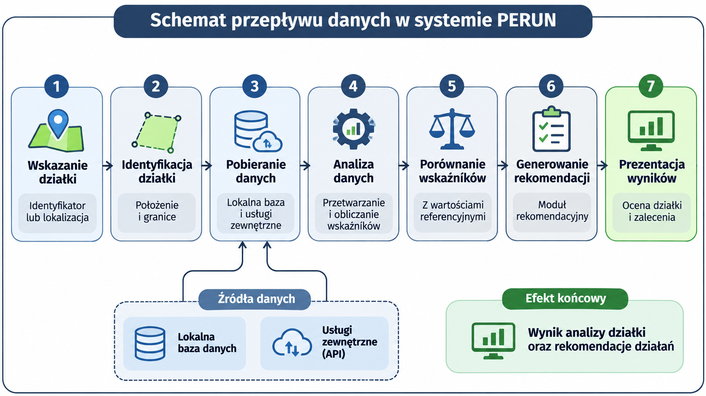

# Perun — asystent gospodarowania wodą na działkach rolnych


| Informacja | Wartość |
| --- | --- |
| Zespół | **Rzeszowska Grupa IT** |
| Nazwa aplikacji | **Perun** |
| Opis wersji | Ukończony prototyp aplikacji |
| Wersja / commit | 1.0 |
| Data opracowania dokumentacji | 2026-11-22 |

> **HACKNATION 2026 — zadanie KOWR**  
> „Zatrzymaj wodę, chroń plony – Inteligentne wsparcie gospodarowania wodą w rolnictwie”

## Spis treści

1. [Cel, problem i korzyści](#1-cel-problem-i-korzyści)
2. [Możliwości PERUNA](#2-możliwości-peruna)
3. [Instrukcja uruchomienia](#3-instrukcja-uruchomienia)
4. [Od działki do decyzji — scenariusz użytkownika](#4-od-działki-do-decyzji--scenariusz-użytkownika)
5. [Architektura i przepływ danych](#5-architektura-i-przepływ-danych)
6. [Dane: źródła, zakresy i aktualność](#7-dane-źródła-zakresy-i-aktualność)
7. [Metody analityczne i reguły rekomendacyjne](#8-metody-analityczne-i-reguły-rekomendacyjne)
8. [Format raportu i jego interpretacja](#9-format-raportu-i-jego-interpretacja)
9. [Biblioteki, integracje, licencje i AI](#10-biblioteki-integracje-licencje-i-ai)
10. [Znane ograniczenia techniczne rozwiązania](#11-znane-ograniczenia-techniczne-rozwiązania)
11. [Weryfikacja wyników i jakość](#12-weryfikacja-wyników-i-jakość)
12. [Rozwój i skalowalność](#13-rozwój-i-skalowalność)
---

## 1. Cel, problem i korzyści

### 1.1. Problem

Rolnicy potrzebują czytelnej informacji o niedoborach opadów, stanie wilgotności gleby i lokalnych czynnikach zwiększających podatność działki na suszę. Dane meteorologiczne, glebowe, wysokościowe i hydrologiczne pochodzą z różnych usług. Samodzielne zestawienie ich, uwzględnienie rodzaju uprawy i wyciągnięcie wniosków wymaga wiedzy technicznej.

Projekt ma integrować dane dotyczące wskazanej lokalizacji, wyznaczać wskaźniki niedoboru wody i tworzyć **rekomendacje wynikające z obliczeń**. Przedstawiony w repozytorium prototyp jest przygotowany pod przyszłą współpracę ze specjalizowanymi miernikami pozwalającymi analizować warunki na obszarze pola uprawnego w czasie rzeczywistym.

### 1.2. Założony rezultat

Docelowy użytkownik wskazuje działkę, wybiera uprawę i datę analizy, a aplikacja przedstawia ocenę warunków wodnych, historycznych niedoborów, wpływu gleby, rzeźby terenu oraz sąsiedztwa cieków i zbiorników. Na tej podstawie generuje zalecenia związane z monitorowaniem, retencją, agrotechniką i rozważeniem nawadniania. Aplikacja jest przystowana pod przyszłą integrację z systemami automatycznej irygacji gruntu.

**Zakres aplikacji** obejmuje m.in. API analizujące punkt, obliczenia oraz raport w formacie JSON, działający interfejs graficzny, wyszukiwanie po identyfikatorze działki ewidencyjnej, analizę satelitarną oraz eksport raportu do pliku PDF. 

### 1.3. Korzyści dla użytkownika

- Zebranie wielu rodzajów informacji środowiskowych w jednym wyniku analitycznym.
- Porównanie opadów z miesięcznymi wartościami normatywnymi przypisanymi do uprawy.
- Wskazanie miesięcy, w których historycznie powtarzały się niedobory.
- Uzyskanie rekomendacji z uzasadnieniem odnoszącym się do danych wejściowych.
- Zobaczenie źródeł i ograniczeń analizy zamiast otrzymania bezwarunkowej porady.

Na finalną wersję produktu składać się będzie narzędzie współpracujące z automatycznym systemem irygacji wydające werdykt na temat nawodnienia pola uprawnego na podstawie informacji uzyskanych z otwartych źródeł historycznych, prognoz oraz obecnego stanu pola uprawnego poznanego dzięki przygotowanym czujnikom.

---

## 2. Możliwości PERUNA

**PERUN zamienia rozproszone dane o pogodzie, glebie i otoczeniu gospodarstwa w jeden czytelny obraz ryzyka niedoboru wody.** Zamiast analizować osobno wiele map i serwisów, użytkownik otrzymuje zestaw wskaźników, ich kontekst historyczny i rekomendacje oparte na jawnych regułach.

### 2.1. Funkcje systemu

| Obszar | Co zapewnia PERUN | Korzyść dla użytkownika |
| --- | --- | --- |
| Analiza lokalizacji | Ocena wskazanego punktu geograficznego i przypisanej uprawy | Szybkie rozpoczęcie analizy wybranego miejsca |
| Opady atmosferyczne | Zestawienie sum opadów z miesięcznym zapotrzebowaniem uprawy | Łatwiejsze rozpoznanie potencjalnych niedoborów |
| Perspektywa wieloletnia | Historia deficytów, ich powtarzalność i anomalie opadów | Zrozumienie, czy problem ma charakter incydentalny czy powtarzalny |
| Wilgotność gleby | Analiza danych dla warstw 0–7 cm i 7–28 cm | Dodatkowy kontekst stanu uwilgotnienia |
| Gleba i ukształtowanie terenu | Informacje o typie gleby, wysokości i lokalnym nachyleniu | Rozpoznanie uwarunkowań retencji i spływu wody |
| Otoczenie hydrologiczne | Wyszukiwanie cieków i zbiorników w sąsiedztwie lokalizacji | Wstępne rozeznanie zasobów wodnych w okolicy |
| Ocena ryzyka | Interpretowalny wskaźnik punktowy w skali 0–100 | Szybki odczyt sytuacji i najważniejszych czynników |
| Rekomendacje | Zalecenia dotyczące monitoringu, retencji, agrotechniki i możliwości nawadniania | Przejście od danych do propozycji działań |
| Integracja | REST API, JSON, konta użytkowników, pola i czujniki | Fundament dalszej rozbudowy usług dla gospodarstw |

### 2.2. Co wyróżnia rozwiązanie

- **Jedna analiza, wiele źródeł:** połączenie meteorologii, uwarunkowań glebowych, rzeźby terenu i hydrologii.
- **Rekomendacje z uzasadnieniem:** każda wskazówka może być powiązana z konkretnym progiem lub zaobserwowanym wskaźnikiem.
- **Historyczne tło decyzji:** ocena nie opiera się wyłącznie na pojedynczym odczycie.
- **Modułowa architektura:** moduły danych, analityki i rekomendacji mogą rozwijać się niezależnie.
- **Gotowość koncepcyjna do IoT:** model pól i sensorów tworzy punkt wyjścia do integracji rzeczywistych pomiarów i automatycznego nawadniania.

### 2.3. Obecny zakres i kierunek produktu

PERUN to inteligentny system wspomagania gospodarowania wodą na działkach rolnych, integrujący dane meteorologiczne, glebowe, hydrologiczne i przestrzenne. Aplikacja umożliwia wyszukiwanie działek, analizę warunków wodnych oraz generowanie spersonalizowanych rekomendacji dotyczących retencji, nawadniania i ograniczania skutków suszy. Wyniki prezentowane są w przejrzystym interfejsie oraz raportach analitycznych. Docelowo PERUN będzie współpracować z czujnikami terenowymi i systemami automatycznej irygacji, wspierając efektywne zarządzanie zasobami wodnymi zarówno na małych jak i dużych gospodarstwach.

---

## 3. Instrukcja uruchomienia

PERUN wykorzystuje backend Python/FastAPI, bazę PostgreSQL oraz usługi dostarczające dane środowiskowe.

### 3.1. Wymagania
- Zainstalowany system kontroli wersji Git
- Zainstalowane środowisko Docker
- Dostęp do Internetu

### 3.2. Instalacja 

1. Sklonować repozytorium:

```
git clone https://github.com/majkus522/hacknation.git
```
2. W środowisku Docker przejść do lokalizacji repozytorium, otworzyć konsolę i wpisać komendę:

```
docker compose up --build
```

3. Po załadowaniu się wszystkich bibliotek i baz danych w przeglądarce internetowej wejść pod adres:

```
http://localhost:8081/
```

---

## 4. Od działki do decyzji — scenariusz użytkownika

1. **Wybór lokalizacji:** użytkownik wskazuje działkę na mapie, podaje jej identyfikator lub współrzędne.
2. **Wskazanie uprawy:** system dobiera zapisane w bazie normy opadów dla wybranej uprawy.
3. **Wybór daty:** użytkownik określa dzień, do którego odnosi się analiza.
4. **Przetwarzanie danych:** moduły zbierają dane meteorologiczne, glebowe, wysokościowe i hydrologiczne.
5. **Ocena sytuacji:** algorytmy obliczają deficyty, anomalie i wskaźnik ryzyka.
6. **Rekomendacje:** system prezentuje działania wraz z wyjaśnieniem ich podstaw.
7. **Raport:** wynik może zostać wykorzystany w interfejsie użytkownika lub eksportowany do pliku PDF.

---

## 5. Architektura i przepływ danych

PERUN został podzielony na warstwy: komunikację HTTP, integrację danych, obliczenia wskaźników, reguły rekomendacji i prezentację wyników. Dzięki temu rozbudowa o nowe wskaźniki nie wymaga przebudowy całego systemu.

### 5.1. Przepływ danych



---
## 6. Dane: źródła, zakresy i aktualność

Wiarygodność rekomendacji zaczyna się od danych. PERUN łączy informacje przechowywane lokalnie z danymi pobieranymi podczas analizy.

### 6.1. Źródła informacji

| Źródło | Zakres | Rola w analizie | Sposób pozyskania |
| --- | --- | --- | --- |
| Instancja zgodna z Open-Meteo | Dobowe sumy opadów, dobowa amplituda temperatury, wilgotność gleby na głębokościach 0–7 i 7–28 cm | Warunki meteorologiczne i historyczne | Lokalna kopia otwartej bazy danych na stan 21.11.2026|
| Instancja zgodna z Open-Meteo | Wysokość punktu centralnego i czterech punktów sąsiednich | Nachylenie i ekspozycja terenu | Lokalna kopia otwartej bazy danych na stan 21.11.2026|
| Geoportal - Mapa Glebowo-Rolnicza | Atrybuty typu i kompleksu gleby | Właściwości gleby | Zapytanie API |
| OpenStreetMap / Overpass | Cieki, kanały, zbiorniki i akweny | Otoczenie hydrologiczne | Zapytanie przestrzenne API |
| PostgreSQL | Uprawy, miesięczne optymalne normy opadów dla poszczególnych plonów, pola, użytkownicy | Parametry i dane aplikacyjne | Odczyt SQL |
| Google Weather API / Open-Meteo publiczne | Bieżące warunki pogodowe | Osobna usługa pogodowa | Zapytanie HTTP |
| Dane użytkownika | Współrzędne, uprawa, data | Kontekst lokalizacji | Parametry zapytania |

### 6.2. Dane bieżące i wcześniej przygotowane

| Dane | Mechanizm użycia | Aktualność / data przygotowania |
| --- | --- | --- |
| Historyczna meteorologia i wilgotność | Pobieranie w trakcie wywołania analizy z instancji archiwalnej | Stan archiwum na 21.11.2026 z zakresu 01.01.2016-21.11.2026 |
| Normy opadowe upraw | Odczyt wcześniej przygotowanych rekordów PostgreSQL | Stan na 22.11.2026; źródło norm: **https://nawozy.eu/wiedza/porady-ekspertow/rosliny/ile-wody-potrzebuja-rosliny-uprawne** |
| Gleba | Zapytanie na żądanie do WMS | Aktualność warstwy zgodna z metadanymi usługi |
| Rzeźba terenu | Zapytanie na żądanie do serwisu wysokości | Aktualność źródła według metadanych |
| Hydrologia | Zapytanie na żądanie do Overpass | Stan na 22.11.2026 |
| Bieżąca pogoda | Odrębne zapytanie w module pogodowym | Czas obserwacji podany przez dostawcę |
| Ocena ryzyka i rekomendacje | Obliczane przez aplikację dla parametrów żądania | Wynik powstaje podczas analizy; nie jest gotową poradą pobieraną z bazy |


### 6.3. Okna analityczne

- **Ocena okresowa:** ostatnie 30 dni kończących się w dniu analizy.
- **Perspektywa historyczna:** około 10 lat wstecz względem wybranej daty.
- **Analiza glebowa:** warstwy wilgotności 0–7 cm i 7–28 cm.
- **Hydrologia:** promień wyszukiwania ustawiany parametrem `radius_m` (100–50 000 m, domyślnie 5000 m).
- **Zakres dostępnych dat:** zależy od konfiguracji archiwum; opisany wariant backendu przyjmuje daty do 2016-12-31.

---

## 7. Metody analityczne i reguły rekomendacyjne

Najważniejszą cechą systemu jest **przejrzysty związek między danymi, wynikiem liczbowym i rekomendacją**. Silnik analityczny korzysta z deterministycznych obliczeń i interpretowalnych progów.

### 7.1. Opady a potrzeby uprawy

Dzienne opady sumowane są do miesięcy:

$$P_{y,m} = \sum_{d \in (y,m)} P_d$$

Niedobór względem normy uprawy:

\[
D_{y,m}=\max(N_m-P_{y,m},0)
\]

Gdzie `P` oznacza opad w mm, a `N_m` — normę przypisaną do uprawy i miesiąca. Wynik pozwala wskazać okresy, w których opady były niższe od przyjętej wartości odniesienia. W przypadku niepełnych miesięcy należy uwzględnić odpowiednie przeskalowanie norm lub oznaczyć ograniczoną porównywalność okresów.

### 7.2. Historia i powtarzalność

Moduł historyczny określa:

- liczbę miesięcy z niedoborem;
- średni dodatni deficyt oraz największy deficyt;
- liczbę epizodów niedoboru w obserwowanej sekwencji miesięcy;
- średnie opady według miesięcy oraz odchylenia od tych średnich;
- częstość niedoborów dla poszczególnych miesięcy.

Powtarzalność jest obliczana jako udział obserwowanych lat z niedoborem w danym miesiącu:


```math

f_m=\frac{\text{liczba lat z niedoborem w miesiącu }m}{\text{liczba lat z porównywalnymi danymi dla miesiąca }m}

```

### 7.3. Wilgotność gleby

Średnie wilgotności w warstwach 0–7 i 7–28 cm są porównywane z historycznymi wartościami dla analogicznego miesiąca. Ujemna anomalia wskazuje na niższe uwilgotnienie względem przyjętej bazy porównawczej. Wartości opisują wilgotność objętościową; jednostki należy prezentować zgodnie z metadanymi źródła (typowo m³/m³).

### 7.4. Teren i hydrologia

Nachylenie terenu jest oszacowywane z różnic wysokości w pięciu punktach. Klasyfikacja spływu:

| Nachylenie | Kategoria ryzyka spływu |
| --- | --- |
| poniżej 2% | Niskie |
| od 2% do poniżej 6% | Umiarkowane |
| od 6% do poniżej 15% | Wysokie |
| co najmniej 15% | Bardzo wysokie |

Obiekty wodne są wyszukiwane w zadanym promieniu. Odległości liczone są na podstawie geometrii udostępnionej przez OSM; służą rozeznaniu przestrzennemu i nie stanowią oceny prawnej ani technicznej możliwości poboru wody.

### 7.5. Indeks ryzyka 0–100

PERUN łączy kilka niezależnych sygnałów w jeden wynik liczbowy. To **heurystyczny indeks oceny**, a nie statystyczne prawdopodobieństwo wystąpienia suszy.

| Sygnał | Reguła | Punkty |
| --- | --- | ---: |
| Niedobór opadów w ocenianym oknie | ≥ 40 mm / od 20 do poniżej 40 mm | +35 / +20 |
| Największy historyczny niedobór | ≥ 40 mm / od 20 do poniżej 40 mm | +25 / +15 |
| Powtarzalność niedoboru | częstość w dowolnym miesiącu ≥ 0,4 | +20 |
| Anomalia wilgotności gleby | poniżej -0,05 | +20 |
| Gleba o potencjalnie słabej retencji | wybrane klasy opisowe (np. piaski, żwiry) | +15 |
| Duże nachylenie | wysokie lub bardzo wysokie ryzyko spływu | +15 |

Łączny wynik jest ograniczany do 100. Interpretacja:

| Wynik | Poziom ryzyka |
| --- | --- |
| 0–19 | Bardzo niski |
| 20–39 | Niski |
| 40–69 | Umiarkowany |
| 70–100 | Wysoki |

### 7.6. Rekomendacje wynikające z obliczeń

| Warunek analityczny | Przykładowy kierunek działania |
| --- | --- |
| Niedobór opadów ≥ 20 mm | Ocena zasadności uzupełniającego nawadniania |
| Niedobór ≥ 20 mm i ciek/zbiornik w promieniu do 2 km | Rozpoznanie możliwości technicznych i formalnych wykorzystania źródła wody |
| Wyraźnie ujemna anomalia wilgotności lub gleba o niskiej retencji | Działania poprawiające zdolność gleby do zatrzymywania wody |
| Wysokie ryzyko spływu | Ograniczanie odpływu powierzchniowego i erozji |
| Powtarzalne historyczne niedobory | Przegląd terminów siewu i doboru agrotechniki |
| Brak sygnałów przekraczających progi | Kontynuacja monitorowania warunków |

---


## 8. Format raportu i jego interpretacja

### 8.1. Struktura odpowiedzi

System **PERUN** generuje szczegółowy raport analityczny w formacie PDF, przedstawiający ocenę warunków wodnych wybranej działki rolnej. Dokument integruje wyniki analiz meteorologicznych, glebowych, hydrologicznych i przestrzennych, prezentując je w przejrzystej formie wraz z rekomendacjami dotyczącymi gospodarowania wodą.

Raport składa się z następujących elementów:

1. **Identyfikacja działki** – identyfikator ewidencyjny, lokalizacja, współrzędne geograficzne, wybrana uprawa oraz data analizy.
2. **Ocena ryzyka suszy** – syntetyczny wskaźnik w skali 0–100 punktów wraz z klasyfikacją poziomu ryzyka i wskazaniem najważniejszych czynników wpływających na wynik.
3. **Sytuacja wodna** – zestawienie opadów atmosferycznych, norm przypisanych uprawie oraz obliczonych niedoborów w poszczególnych miesiącach.
4. **Wilgotność i właściwości gleby** – charakterystyka gleby oraz poziom wilgotności w warstwach 0–7 cm i 7–28 cm, porównany z wartościami referencyjnymi.
5. **Historyczna podatność na suszę** – analiza częstotliwości i wielkości niedoborów opadów, okresów suchych oraz anomalii względem dostępnych danych historycznych.
6. **Ukształtowanie terenu i hydrologia** – wysokość terenu, nachylenie, kierunek stoku, ryzyko spływu powierzchniowego oraz informacje o pobliskich ciekach i zbiornikach wodnych.
7. **Rekomendacje** – propozycje działań dotyczących nawadniania, retencji i agrotechniki wraz z uzasadnieniem opartym na wynikach analizy.
8. **Źródła i ograniczenia** – wykaz wykorzystanych danych, dat ich pozyskania, zastosowanych metod oraz czynników wpływających na dokładność wyników.

### 8.2. Interpretacja wyników

Najważniejszym elementem raportu jest **ocena ryzyka suszy**, wyrażona w punktowej skali od 0 do 100. Wskaźnik powstaje na podstawie analizy niedoborów opadów, wilgotności i właściwości gleby, historycznej powtarzalności okresów suchych oraz charakterystyki ukształtowania terenu.

**Przykładowy raport** dla działki `041005_5.0039.3235/2`, analizowanej pod kątem uprawy kukurydzy na dzień 19 lipca 2016 r., wykazał **wysoki poziom ryzyka suszy wynoszący 70/100 punktów**.

Najważniejsze wyniki przeprowadzonej analizy:

| Parametr | Wynik | Interpretacja |
| --- | --- | --- |
| Ryzyko suszy | 70/100 | Wysoki poziom zagrożenia |
| Niedobór opadów | 46,4 mm | Deficyt względem norm uprawy |
| Wilgotność gleby 0–7 cm | 0,191 m³/m³ | Wartość zgodna z dostępną wartością referencyjną |
| Wilgotność gleby 7–28 cm | 0,151 m³/m³ | Wartość zgodna z dostępną wartością referencyjną |
| Miesiące poniżej normy | 2 | Niedobory w maju i czerwcu 2016 r. w analizie historycznej |
| Największy historyczny niedobór | 14,8 mm | Maj 2016 r. |
| Nachylenie terenu | 0,7% | Niskie ryzyko spływu powierzchniowego |

Na podstawie uzyskanych wyników PERUN wygenerował trzy rekomendacje:

- **Uzupełnienie niedoboru wody** – ocena możliwości dodatkowego nawodnienia ze względu na deficyt opadów przekraczający 20 mm.
- **Poprawa retencji gleby** – rozważenie działań zwiększających zdolność zatrzymywania wody ze względu na właściwości analizowanego podłoża.
- **Dostosowanie agrotechniki** – rozważenie zmiany terminów siewu lub struktury upraw w związku z niedoborami obserwowanymi w maju i czerwcu.

W przedstawionym przykładzie analiza historyczna obejmuje okres od 1 stycznia do 19 lipca 2016 r. Oznacza to, że wartości referencyjne i powtarzalność niedoborów wyznaczono na podstawie ograniczonego zakresu danych, a nie pełnej wieloletniej historii.

**Wyniki raportu stanowią wsparcie w podejmowaniu decyzji rolniczych**, umożliwiając identyfikację zagrożeń oraz wybór działań ograniczających skutki niedoborów wody. Punktowa ocena ryzyka nie oznacza procentowego prawdopodobieństwa wystąpienia suszy, a rekomendacje powinny być interpretowane z uwzględnieniem dostępności i dokładności danych źródłowych.

---

## 9. Biblioteki, integracje, licencje i AI

### 9.1. Technologie


| Technologia | Rola | Licencja / warunki |
| --- | --- | --- |
| FastAPI | Obsługa API HTTP i dokumentacja OpenAPI | MIT License |
| Uvicorn | Serwer ASGI | BSD 3-Clause License |
| SQLAlchemy | Dostęp do bazy danych i ORM | MIT License |
| Pydantic | Walidacja danych | MIT License |
| `psycopg2-binary` | Sterownik PostgreSQL | LGPL 3.0 z wyjątkami |
| `python-jose` | Obsługa tokenów JWT | MIT License |
| `passlib` 1.7.4 | Haszowanie i weryfikacja haseł | BSD License |
| `bcrypt` 4.0.1 | Bezpieczne haszowanie haseł | Apache License 2.0 |
| `requests` | Synchroniczna komunikacja HTTP | Apache License 2.0 |
| `httpx` | Asynchroniczna komunikacja HTTP | BSD 3-Clause License |
| `pandas` | Przetwarzanie danych tabelarycznych | BSD 3-Clause License |
| PostgreSQL | Relacyjna baza danych aplikacji | PostgreSQL License |
| Python 3.12 | Środowisko wykonawcze backendu | Python Software Foundation License v2 |


### 9.2. Zewnętrzne źródła i warunki wykorzystania

| Dostawca | Zastosowanie | Informacje licencyjne do udokumentowania |
| --- | --- | --- |
| Open-Meteo / źródłowe archiwum danych | Pogoda, wilgotność, wysokość | Dane API: CC BY 4.0, z obowiązkiem przypisania źródła. Bezpłatne publiczne API: zastosowania niekomercyjne, do 10 000 zapytań dziennie. |
| Geoportal | Mapa glebowo-rolnicza | Oficjalna usługa WMS udostępnia dane z państwowego zasobu geodezyjnego i kartograficznego. |
| OpenStreetMap | Dane hydrologiczne | Open Database License (ODbL 1.0). Wymagane przypisanie autorstwa, a przy udostępnianiu określonych zmodyfikowanych baz danych mogą obowiązywać zasady współdzielenia na tej samej licencji. |
| Overpass API | Techniczny dostęp do danych OSM |Dane zachowują licencję ODbL. Publiczne instancje Overpass mają osobne zasady wykorzystania zasobów i limity obciążenia. |
| Google Weather API | Opcjonalne dane pogodowe | Własnościowa usługa Google Maps Platform. Obowiązują warunki platformy, wymagania atrybucji oraz rozliczenia według wykorzystania API. |

### 9.3. Sztuczna inteligencja i logika ekspercka

PERUN wykorzystuje **wyjaśnialny silnik reguł eksperckich**. Ocena ryzyka i rekomendacje powstają w wyniku jawnych obliczeń i progów, a nie generowania dowolnej treści przez model językowy. To ułatwia kontrolę poprawności zaleceń i śledzenie ich przesłanek.

Narzędzia AI użyte podczas tworzenia kodu, dokumentacji lub projektowania interfejsu należy wykazać osobno: Gemini Hydrogen z rozszerzonym poziomem myślenia - wsparcie w generowania kodu. Włączenie modeli uczenia maszynowego do samego silnika analitycznego może stanowić kolejny etap rozwoju po przygotowaniu danych walidacyjnych.

---

## 10. Znane ograniczenia techniczne rozwiązania

- Aplikacja działa jedynie dla ewidencji gruntów na terenie Rzeczpospolitej.

---

## 11. Weryfikacja wyników i jakość

System ekspercki jest najbardziej użyteczny, gdy jego wyniki można **odtworzyć i zweryfikować**. PERUN wykorzystuje wskaźniki, dla których możliwe jest niezależne przeliczenie na podstawie tych samych danych.

### 11.1. Metody kontroli

| Obszar | Metoda weryfikacji | Oczekiwany rezultat |
| --- | --- | --- |
| Opady | Porównanie sum z dobowymi danymi źródłowymi | Zgodna suma w mm |
| Deficyt | Ręczne przeliczenie `max(norma - opad, 0)` | Zgodny wynik i obsługa braków |
| Historia | Niezależne wyznaczenie średnich i częstości | Zgodność agregacji dla wybranego okresu |
| Wilgotność | Kontrola warstwy, jednostki i średniej referencyjnej | Poprawna interpretacja anomalii |
| Rzeźba terenu | Porównanie nachylenia z wysokościami źródłowymi | Zgodna klasyfikacja spływu |
| Hydrologia | Porównanie obiektów i odległości na mapie | Poprawna lokalizacja i oznaczenie przybliżeń |
| Ryzyko | Sprawdzenie każdego progu punktowego | Powtarzalny wynik 0–100 |
| Rekomendacje | Przypadki testowe dla każdej reguły | Zalecenie zgodne z przesłankami |


## 12. Rozwój i skalowalność

Długoterminowa wizja **PERUNA** zakłada przekształcenie systemu analitycznego w kompleksową platformę inteligentnego zarządzania zasobami wodnymi w rolnictwie. Rozwój rozwiązania będzie koncentrował się na automatyzacji procesów, wykorzystaniu sztucznej inteligencji oraz integracji danych satelitarnych, meteorologicznych i pomiarów terenowych.

### 12.1. Strategiczne kierunki rozwoju

1. **Autonomiczne zarządzanie nawadnianiem (Smart Irrigation)**

   Integracja PERUNA z inteligentnymi systemami irygacji, pompami i elektrozaworami umożliwi automatyczne sterowanie nawadnianiem na podstawie prognoz pogody, wilgotności gleby i zapotrzebowania upraw. System będzie optymalizował dawki i harmonogramy nawadniania, ograniczając zużycie wody oraz energii.

2. **Cyfrowy bliźniak gospodarstwa (Digital Twin)**

   Stworzenie wirtualnego modelu gospodarstwa odwzorowującego właściwości gleby, ukształtowanie terenu, uprawy i infrastrukturę wodną. Rozwiązanie umożliwi symulowanie skutków suszy, intensywnych opadów oraz różnych strategii nawadniania, wspierając planowanie inwestycji i zarządzanie zasobami.

3. **Predykcja suszy i analiza satelitarna z wykorzystaniem AI**

   Rozbudowa silnika analitycznego o modele uczenia maszynowego wykorzystujące wieloletnie dane meteorologiczne, zobrazowania Sentinel-1 i Sentinel-2 oraz wskaźniki NDVI, NDWI i NDMI. Pozwoli to prognozować zagrożenie suszą, wykrywać stres wodny roślin i identyfikować obszary wymagające interwencji.

4. **Inteligentna sieć czujników IoT**

   Integracja z czujnikami wilgotności i temperatury gleby, poziomu wód oraz lokalnymi stacjami meteorologicznymi. Wykorzystanie technologii LoRaWAN i NB-IoT umożliwi monitorowanie gospodarstw w czasie rzeczywistym, generowanie automatycznych alertów oraz dostosowywanie rekomendacji do rzeczywistych warunków terenowych.

5. **Regionalna platforma zarządzania zasobami wodnymi**

   Rozszerzenie PERUNA na poziom wielu gospodarstw i całych regionów rolniczych. Agregacja danych umożliwi tworzenie map zagrożenia suszą, identyfikację obszarów wymagających inwestycji retencyjnych oraz opracowywanie scenariuszy adaptacji rolnictwa do zmian klimatycznych.

### 12.2. Skalowanie architektury

Rozwój PERUNA zakłada przejście w kierunku skalowalnej architektury umożliwiającej jednoczesną obsługę wielu gospodarstw oraz przetwarzanie dużych zbiorów danych przestrzennych i czasowych.

Najważniejsze kierunki rozwoju infrastruktury obejmują:

- **Rozproszone przetwarzanie danych** – wykorzystanie zadań asynchronicznych i kolejek do wykonywania analiz satelitarnych, prognoz oraz symulacji.
- **Przestrzenne bazy danych** – wykorzystanie PostgreSQL/PostGIS do analiz geometrii działek, stref nawadniania i obiektów hydrologicznych.
- **Lokalne repozytorium danych** – przechowywanie przygotowanych zbiorów meteorologicznych i przestrzennych w celu ograniczenia zależności od dostępności zewnętrznych usług.
- **Architektura chmurowa** – konteneryzacja i automatyczne skalowanie komponentów odpowiedzialnych za API, obliczenia i przetwarzanie danych.
- **Integracja urządzeń IoT** – wydzielona infrastruktura komunikacyjna do odbierania i przetwarzania dużych strumieni pomiarów terenowych.
- **Monitoring i niezawodność** – automatyczne testowanie, rejestrowanie jakości danych, monitorowanie czasu odpowiedzi oraz kontrola poprawności generowanych rekomendacji.

Docelowo PERUN będzie rozwijany jako **modułowa platforma wspomagania i automatyzacji decyzji w rolnictwie**, łącząca obserwację środowiska, predykcję zagrożeń, symulowanie scenariuszy i sterowanie infrastrukturą wodną.
